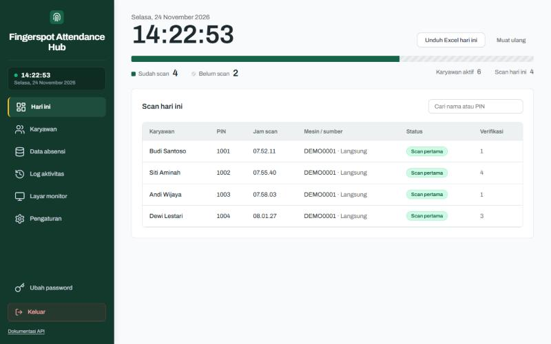

# Fingerspot Attendance Hub

[Bahasa Indonesia](README.md)

A self-hosted attendance server for **Fingerspot** machines connected to [developer.fingerspot.io](https://developer.fingerspot.io). It receives scans in real time through webhooks, pulls missed scans, and manages employees across machines from one place. The user interface is in Indonesian.



> Not affiliated with Fingerspot. The Fingerspot name and trademarks belong to their owner.

## Features

- **Real-time scans** through the `attlog` webhook, deduplicated when resent.
- **Pull scans** from the cloud (`get_attlog`) after downtime.
- **Two-way employee sync**: pull from a machine, push to others, rename, deactivate, reactivate.
- **Fingerprint-safe**: the template is copied before anything is deleted or changed on a machine. Without a copy, the deletion is cancelled.
- **Confirmed queue**: an item is marked synced only after the machine replies. Failures show a reason and can be retried.
- **Machine control**: info, clock sync, restart.
- **Monitor screen** for lobbies and guard posts.
- **Import and export** of Fingerspot scan logs and employees.
- **Operations**: five roles, audit log, automatic backup and restore.

Overtime, shift, leave, and payroll rules are deliberately out of scope. Read scans through the API or exports and apply your own rules.

## Quick start

You need a Fingerspot machine active on fingerspot.io, its Cloud ID, a developer API key, Docker Compose, and a public URL for the webhook.

```bash
git clone https://github.com/alzithetrivialmind/fingerspot-attendance-system.git
cd fingerspot-attendance-system
cp .env.example .env      # fill FINGERSPOT_API_KEY, POSTGRES_PASSWORD, JWT_SECRET_KEY, WEBHOOK_TOKEN
docker compose up -d --build
docker compose logs app | grep "Akun pertama"    # first admin password
```

1. Open `http://localhost:8000`, log in as `admin`, and change the password.
2. Add the machine in *Pengaturan > Mesin absensi > Tambah mesin* using its Cloud ID. Webhooks from unregistered machines are rejected.
3. Set the webhook URL on developer.fingerspot.io to `https://your-domain/webhook/fingerspot?token=<WEBHOOK_TOKEN>`.
4. Click *Tarik karyawan* to pull employees, then scan. Scans from unregistered PINs appear on the monitor but are not stored.

All settings are documented in [.env.example](.env.example), the interactive API reference is at `/docs`, and integration details are in [docs/integrasi-fingerspot.md](docs/integrasi-fingerspot.md) (Indonesian).

## Security

Run it behind HTTPS and set `WEBHOOK_TOKEN`. Fingerprint templates are biometric data stored in the database and its backups. They are never returned by the API or written to logs. See [SECURITY.md](SECURITY.md).

## Known limits

- Tables are created on first start. There are no schema migrations yet.
- Run a single process: the monitor feed and queue timing live in memory.
- Tested only with the Revo WDV-204BNC.

## License

[MIT](LICENSE)
