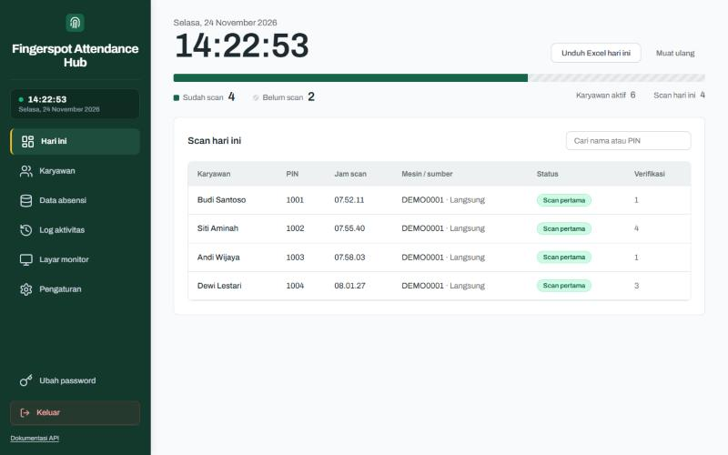
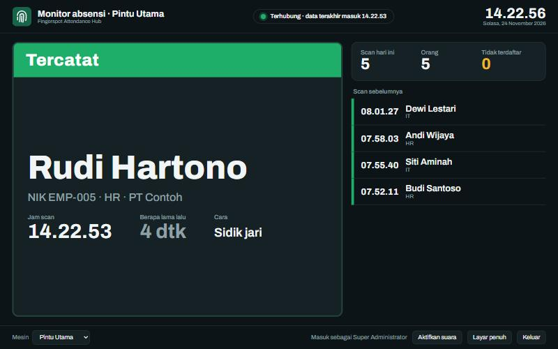
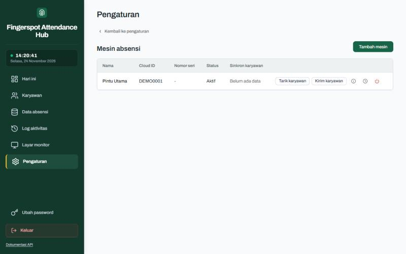
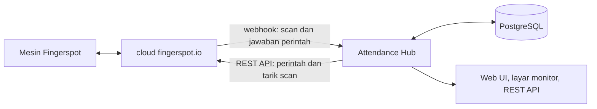

# Fingerspot Attendance Hub

[](https://github.com/alzithetrivialmind/fingerspot-attendance-system/actions/workflows/tests.yml)
[](LICENSE)

[English](README.en.md)

Server absensi yang dijalankan sendiri (*self-hosted*) untuk mesin **Fingerspot** yang terhubung ke [developer.fingerspot.io](https://developer.fingerspot.io). Aplikasi ini menerima scan secara langsung lewat webhook, menarik scan yang tertinggal, dan mengelola karyawan di banyak mesin dari satu tempat.



> Proyek ini tidak berafiliasi dengan Fingerspot. Nama dan merek Fingerspot adalah milik pemiliknya.

## Fitur

- **Scan langsung**: webhook `attlog` masuk ke database dalam hitungan detik, tanpa data dobel walau dikirim ulang.
- **Tarik scan**: ambil ulang scan dari cloud (`get_attlog`) saat server sempat mati.
- **Karyawan dua arah**: tarik karyawan dari mesin, kirim ke mesin lain, ubah nama, nonaktifkan, aktifkan kembali.
- **Aman untuk sidik jari**: sebelum menghapus atau mengubah data di mesin, templatenya disalin dulu. Tanpa salinan, penghapusan dibatalkan.
- **Antrean dengan konfirmasi**: status berubah menjadi tersinkron hanya setelah mesin menjawab. Kegagalan tampil beserta alasannya dan bisa dikirim ulang.
- **Kontrol mesin**: informasi mesin, samakan jam, restart.
- **Layar monitor**: tampilan layar penuh untuk lobi atau pos jaga, lengkap dengan tanda PIN tidak terdaftar dan suara.
- **Import dan export**: scan log Fingerspot (`.xls`, `.xlsx`, `.csv`) dan data karyawan.
- **Operasional**: lima tingkat hak akses, log aktivitas, backup otomatis dan restore.

Yang **tidak** ada di sini: perhitungan lembur, shift, cuti, dan penggajian. Aturan itu berbeda di setiap perusahaan. Ambil data scan lewat API atau export, lalu hitung di sistem Anda.

| Layar monitor | Mesin absensi |
|---|---|
|  |  |

## Cara kerja



Perintah ke mesin bersifat asinkron: API hanya menjawab bahwa perintah diterima, hasilnya datang belakangan lewat webhook. Karena itu **server harus bisa dijangkau dari internet**. Detailnya ada di [docs/integrasi-fingerspot.md](docs/integrasi-fingerspot.md).

## Yang dibutuhkan

1. Mesin Fingerspot yang sudah aktif di cloud fingerspot.io, beserta **Cloud ID**-nya.
2. Akun [developer.fingerspot.io](https://developer.fingerspot.io) dan **API key**.
3. Server dengan Docker dan Docker Compose.
4. Alamat publik untuk webhook (domain, port forwarding, atau tunnel).

## Mulai cepat

```bash
git clone https://github.com/alzithetrivialmind/fingerspot-attendance-system.git
cd fingerspot-attendance-system
cp .env.example .env
```

Isi minimal ini di `.env`:

```ini
FINGERSPOT_API_KEY=api-key-anda
POSTGRES_PASSWORD=hurufdanangkasaja
JWT_SECRET_KEY=hasil-perintah-di-bawah
WEBHOOK_TOKEN=rahasia-webhook-anda
```

```bash
python -c "import secrets; print(secrets.token_urlsafe(48))"   # untuk JWT_SECRET_KEY
docker compose up -d --build
docker compose logs app | grep "Akun pertama"                   # password admin pertama
```

Buka `http://localhost:8000`, masuk sebagai `admin`, lalu ganti passwordnya.

## Menghubungkan mesin

1. **Daftarkan mesin** di *Pengaturan > Mesin absensi > Tambah mesin* dengan Cloud ID-nya. Webhook dari mesin yang tidak terdaftar ditolak.
2. **Pasang URL webhook** di dashboard developer.fingerspot.io:

   ```
   https://domain-anda/webhook/fingerspot?token=<WEBHOOK_TOKEN>
   ```

3. **Tarik karyawan**: klik *Tarik karyawan* pada mesin, pilih PIN, simpan. Nama, kartu, dan template sidik jari ikut tersalin.
4. **Coba scan.** Scan muncul di halaman *Hari ini* dan *Layar monitor*.

Scan dari PIN yang belum terdaftar tampil di layar monitor, tetapi tidak disimpan. Daftarkan karyawannya dulu, lalu tarik scan tanggal tersebut.

### Menyalin karyawan ke mesin lain

Tarik karyawan dari mesin tempat sidik jarinya didaftarkan, lalu klik *Kirim karyawan* pada mesin tujuan. Template hanya bisa dipakai antar mesin dengan tipe yang sama.

### Menghapus atau menonaktifkan

Menonaktifkan karyawan menghapusnya dari semua mesin setelah sidik jarinya disalin, sehingga bisa dikembalikan. Karyawan yang sudah punya scan tidak bisa dihapus permanen agar riwayatnya tetap ada.

## Konfigurasi

| Variabel | Bawaan | Keterangan |
|---|---|---|
| `FINGERSPOT_API_KEY` | | API key dari developer.fingerspot.io |
| `POSTGRES_PASSWORD` | | Wajib untuk Docker Compose. Huruf dan angka saja |
| `JWT_SECRET_KEY` | acak | Kosong berarti semua pengguna login ulang setiap restart |
| `WEBHOOK_TOKEN` | | Rahasia di URL webhook, sangat disarankan |
| `ADMIN_USERNAME`, `ADMIN_PASSWORD` | `admin`, acak | Hanya dipakai saat belum ada pengguna |
| `TIMEZONE` | `Asia/Jakarta` | Zona waktu mesin. WITA `Asia/Makassar`, WIT `Asia/Jayapura` |
| `APP_NAME` | Fingerspot Attendance Hub | Nama di tampilan |
| `APP_PORT` | `8000` | Port di server |
| `MONITOR_KEY` | | Buka `/monitor?key=...` tanpa login |
| `BACKUP_HOUR` | `23` | Jam backup harian |
| `ACCESS_TOKEN_EXPIRE_MINUTES` | `1440` | Lama sesi login |

## Hak akses

| Role | Boleh |
|---|---|
| `monitor` | Layar monitor saja |
| `view-only` | Melihat data |
| `operator` | Karyawan, tarik dan import scan, sinkron mesin, log aktivitas |
| `administrator` | Operator, ditambah tambah mesin, jam dan restart mesin, master data, hapus karyawan |
| `super admin` | Semua, termasuk pengguna serta backup dan restore |

## Memakai API

Dokumentasi interaktif ada di `/docs`. Contoh mengambil scan:

```bash
TOKEN=$(curl -s http://localhost:8000/auth/login \
  -d "username=admin&password=PASSWORD" | python -c "import sys,json; print(json.load(sys.stdin)['access_token'])")

curl -H "Authorization: Bearer $TOKEN" \
  "http://localhost:8000/attendance/?from_date=2026-01-01T00:00:00&to_date=2026-01-31T23:59:59&limit=500"
```

| Endpoint | Fungsi |
|---|---|
| `POST /webhook/fingerspot` | Penerima webhook fingerspot.io |
| `GET /attendance/`, `GET /attendance/export` | Data scan, unduh Excel |
| `POST /attendance/pull`, `POST /attendance/import` | Tarik dari cloud, import file |
| `/employees/` | Karyawan, import, export |
| `/devices/` | Mesin, tarik dan kirim karyawan, jam, restart |
| `GET /monitor/feed` | Feed scan langsung |

## Keamanan

- Pasang di belakang HTTPS (Caddy, Nginx, Cloudflare Tunnel). Password, token, dan template sidik jari lewat jaringan.
- Isi `WEBHOOK_TOKEN`. Tanpa itu, siapa pun yang tahu Cloud ID bisa mengirim scan palsu.
- Template sidik jari adalah data biometrik. Template disimpan di database dan backup, tidak keluar lewat API, dan tidak ditulis ke log. Batasi akses ke server dan ikuti aturan perlindungan data yang berlaku (di Indonesia, UU PDP).
- Salin folder `backups/` ke tempat lain secara berkala.

Melaporkan celah keamanan: lihat [SECURITY.md](SECURITY.md).

## Pengembangan

```bash
python -m venv .venv && source .venv/bin/activate    # Windows: .venv\Scripts\activate
pip install -r requirements-dev.txt
pytest                                                # memakai SQLite di memori
uvicorn app.main:app --reload                         # butuh PostgreSQL, lihat DATABASE_URL
```

```
app/
├── routers/     endpoint HTTP (webhook.py = penerima fingerspot.io)
├── services/    fingerspot_api.py (klien API), sync_engine.py (antrean mesin), ...
├── models/      tabel database
├── static/      JavaScript dan CSS tanpa framework
└── templates/   HTML
tests/
docs/
```

Teknologi: Python 3.12, FastAPI, SQLAlchemy, PostgreSQL 16, JavaScript tanpa framework. Kontribusi: lihat [CONTRIBUTING.md](CONTRIBUTING.md).

## Batasan yang diketahui

- Tabel dibuat otomatis saat pertama start. Belum ada migrasi skema untuk versi berikutnya.
- Jalankan satu proses saja: feed monitor dan jadwal antrean disimpan di memori.
- Baru diuji dengan mesin Revo WDV-204BNC. Laporan dari tipe lain sangat membantu.

## Lisensi

[MIT](LICENSE)
